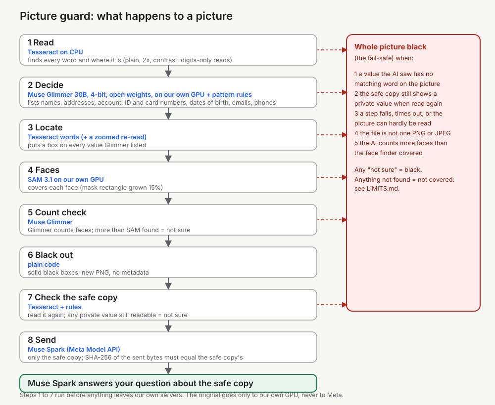

# Picture guard

**Built for the Meta Global AI Developer Hackathon (Startup track).**

- Demo: https://naveed-gilani--picture-guard-demo-web-serve.us-east.modal.run
- Video: VIDEO_LINK
- Repo: https://github.com/navee4/picture-guard

## The problem

People paste screenshots, payslips, letters and photos of ID cards into AI chatbots all the time. Text tools that look for private data cannot see text inside a picture. So names, addresses, account numbers and faces go straight to the AI.

## What Picture guard does

It finds names, addresses, account numbers, ID numbers and faces in a picture. It covers each one with a black box, and sends only that cleaned copy to the AI. If it is not sure, it blacks out the whole picture.

## How it works (and where Meta's models are used)

1. **Read.** Tesseract (on CPU) finds every word and where it is.
2. **Decide.** Pattern rules with check digits (card numbers, IBANs, NI numbers, sort codes) plus **Muse Glimmer** (open weights, 4-bit, on our own GPU) decide what is private, including names, addresses and ID numbers.
3. **Locate.** Each private value gets a box from the words Tesseract found (with a zoomed re-read for hard ones).
4. **Faces.** **SAM 3.1** (on our own GPU) finds faces; Glimmer's face count is a second check.
5. **Black out.** Solid black boxes, written to a new PNG with no metadata.
6. **Check the safe copy.** The cleaned picture is read again; any private value still readable means "not sure".
7. **Ask.** **Muse Spark** answers questions about the **safe copy only**. The answer step calls the model `muse-spark-1.3` (Standard mode) through the Meta Model API (`api.meta.ai`). The code refuses to send anything but the safe copy and your question. On Meta's free credits, Meta may use what is sent for product improvement.

The original picture goes only to our own GPU (Modal), never to Meta's API.

## Meta models used

| Model | Where it runs | What it does here | What it sees |
|---|---|---|---|
| **Muse Glimmer 30B** (open weights, 4-bit GGUF, run with llama.cpp) | our own Modal GPU | decides what is private (names, addresses, ID numbers), gives boxes for hard values, counts faces; temperature 0, seed 1234 | the **original** picture |
| **SAM 3.1** (open weights) | our own Modal GPU | finds faces | the **original** picture |
| **Muse Spark** `muse-spark-1.3` (Standard mode, through the Meta Model API at `api.meta.ai`) | Meta's API | answers the visitor's question | the **safe copy only**, plus the question |

Nothing else of Meta's is used. Tesseract (reader) is not a Meta model. Muse Spark Open was considered and not used (too large for one GPU; `LICENCES.md`).

## The safety rules

Any "not sure" gives a whole black picture. The five fail-safe rules:

1. A value the AI saw has no matching word on the picture, so it cannot be covered safely.
2. After covering, a private value can still be read on the safe copy.
3. A step fails, times out, or the picture can hardly be read.
4. The file is not one PNG or JPEG picture.
5. The AI counts more faces than the face finder covered.

**The proof.** The page and the code check, before anything is sent, that the SHA-256 of the image in the request equals the SHA-256 of the safe copy and never the original's (unit tests refuse the original, a second image, an image URL and a file id). Three leak checks run on every test result: a plain Tesseract read of the safe copy, a stricter read (plain, dark areas inverted, local contrast), and a pixel check of every planted box.

## Results (sealed hold-out, 28 Oct 2026, tag `freeze-1`)

Made-up test pictures only. The hold-out (50 text pictures, 20 + 20 face pictures) was run **once, live**, on the frozen pipeline (git tag `freeze-1`, settings in `FREEZE.md`). Nothing was changed after seeing it. Details and caveats: `LIMITS.md`.

| Hold-out, text pictures | Pictures | Whole picture black | Values left readable / planted, in kept pictures (plain Tesseract, strict read, pixels under 50%) | Planted values under 90% covered | Ordinary text still readable (kept) | Seconds per picture |
|---|---|---|---|---|---|---|
| Chats | 13 | 5 (38%) | 0 / 43 | 1 (at about 90%) | 46 of 164 (28%) | 19.7 |
| ID-style cards | 12 | 0 | 0 / 84 | 0 | 35 of 144 (24%) | 17.3 |
| Letters | 13 | 4 (31%) | 0 / 90 | 0 | 88 of 153 (58%) | 24.5 |
| Payslips | 12 | 4 (33%) | 0 / 64 | 0 | 183 of 248 (74%) | 19.5 |
| **All text** | **50** | **13 (26%)** | **0 / 281** | **1 of 281** | **352 of 709 (50%)** | **20.3** |

| Hold-out, face pictures | Pictures | Whole picture black | Faces covered 90% or more (kept pictures) | Seconds per picture |
|---|---|---|---|---|
| Faces on cards and chats (AI-made faces) | 20 | 0 | 45 of 45 | 8.7 |
| Harder faces (side views, hats, masks, groups) | 20 | 1 (5%) | 33 of 34 (one accessory picture, covered 78%) | 5.3 |

The drawn placeholder faces on the text pictures' ID cards are not detected (0 of 12 here; a test-picture limit, the same as on the dev set). The 13 black text pictures: 11 because a private value had no word box, 2 because the safe copy still showed a value. The 1 black harder-face picture: the read stage found almost nothing.

Reading the tables: a black picture is the safe failure, not a leak. "Kept" means the picture was not blacked out whole. No leak was found by any of the three checks on the hold-out.

Development set (the pictures the settings were tuned on, 28 Oct 2026, at the frozen settings): text 150 pictures, 40 black (27%), 0 leaks by all three checks, 1 of 850 planted values under 90%; faces 55 pictures, 1 black, 117 of 117 faces covered; harder faces 60 pictures, 6 black, 112 of 112 covered. Two live runs gave byte-identical safe copies on all 265.

## How judges can check our claims

No command below needs a key, a token or a Modal account. Do the install steps under "Run it" first.

    # 1. the unit tests (model calls are faked, Tesseract is real)
    .venv/bin/python -m unittest discover -s tests -t .
    # 2. the freeze test: the pipeline files are identical to tag freeze-1 (FREEZE.md lists the settings)
    .venv/bin/python -m unittest tests.test_freeze -v
    # 3. protect a made-up sample with no models: names and addresses cannot be judged, so the whole picture goes black (the safe failure)
    .venv/bin/pg protect demo_samples/payslip_000.jpg --no-models --out safe.png --report report.json
    # 4. the hold-out table, recomputed from the saved result files in results/final/
    .venv/bin/python tools/holdout_table.py
    # 5. the public-repo and submission checks
    sh tools/submission_gate.sh

The hold-out result files are `results/final/eval-testset-holdout-fb-zoom.json`, `eval-faces-holdout-fb-zoom.json` and `eval-faces_hard-holdout-fb-zoom.json` (with `.md` tables beside them). The hold-out was run once on tag `freeze-1`; the gate in `pg eval --final` refuses a second run. Running `pg protect` with the models, or `pg eval` live, needs your own Modal account (see below).

## Run it

    uv venv --python 3.12                               # makes .venv (Python 3.12 or newer; or: python3 -m venv .venv)
    uv pip install --python .venv/bin/python -e '.[demo-test,dev]' faker   # the `pg` command, the demo's test tools, the secret scanner, and the test-picture generator's one extra package
    brew install tesseract                              # the reader (a separate program)
    (cd testset && ../.venv/bin/python generate.py --out images)       # makes the 200 made-up test pictures (same seed: byte-identical to ours)
    .venv/bin/pg protect in.png --out safe.png --report report.json    # needs the Modal app (see below)
    .venv/bin/pg eval --set testset --split dev         # measure on made-up test pictures (dev split only)
    .venv/bin/python -m unittest discover -s tests -t .

The models run on Modal only (never on your computer): `pg protect` and `pg eval` start the Modal app for the length of the run. `pg protect --no-models` runs without models; it then blacks out whole pictures whenever names and addresses would need judging.

### The live demo (`picture_guard/demo/`)

A web page over the same pipeline as `pg protect`: pick a made-up sample or upload a PNG/JPEG, see the original beside the safe copy, what was covered (types and counts only), progress per stage, then ask Muse Spark a question about the safe copy. A panel shows the SHA-256 of the original, of the safe copy and of the image bytes in the request to Muse Spark.

- Deploy (Modal, scales to zero; one container each for the web part and the GPU part): `.venv/bin/python tools/deploy_demo.py`. The Muse Spark call uses the Modal secret `meta-model-api` (key `META_MODEL_API_KEY`) if it exists; otherwise the page says "not connected yet" and nothing is sent.
- Limits: 5 MB, 16 megapixels, 8 pictures and 12 questions per visitor per 10 minutes, 200 pictures a day, one picture at a time, 240 s per request.
- Pictures are processed in memory-backed temporary files that are deleted at once. Nothing is stored or logged.
- End to end in a real browser against a deployed demo: `PG_DEMO_URL=... .venv/bin/python -m unittest tests.e2e.test_demo_e2e tests.e2e.test_demo_samples` (needs `uv pip install -e '.[demo-test]'` and `playwright install chromium`).

### Tests

    .venv/bin/python -m unittest discover -s tests -t .     # 140+ tests; the model calls are faked, Tesseract is real
    sh tools/secret_scan.sh                                 # looks for keys and tokens before every commit

## What was built during the hackathon

The hackathon started on 26 Oct 2026. Everything in `picture_guard/`, `tests/`, `tools/` and `docs/` was written from 27 Oct. The made-up test pictures and model spike (`testset/`, `spike/`, `faces/`, `faces_hard/`) were made before it; see `BUILT-BEFORE-HACKATHON.md` and the git tag `pre-hackathon`.

## Test data

All pictures are **made up** (each says "SYNTHETIC TEST DATA"): fictional issuers, banks and employers; published test card numbers; Ofcom's drama phone range; reserved example email domains; a fictional IBAN bank code; AI-made or drawn faces. `testset/` has 200 pictures (150 dev, 50 hold-out) with a key of every planted value and its box; `faces/` (75 pictures) and `faces_hard/` (80 pictures) hold the AI-made face pictures with their keys and scripts. The faces are made up: portraits from Stable Diffusion XL base 1.0 (CreativeML Open RAIL++-M licence, see `LICENCES.md`), none of a real person, placed on made-up cards, chats and scenes. The portraits cannot be regenerated byte for byte, so the composed pictures are committed; the raw portraits are not. The hold-out was run once, on the commit tagged `freeze-1`; nothing was tuned on it.

## Limits

An honest list is in `LIMITS.md`.

## Built by

Built by navee4 (solo builder). AI coding tools (Claude) helped write the code.

## Licence

Our code is licensed under Apache-2.0 (see `LICENSE`). That covers our code only; the models and programs it uses have their own licences, listed in `LICENCES.md`.
